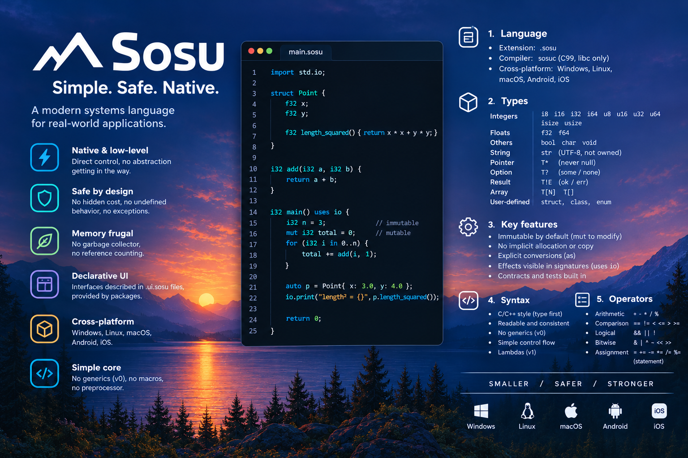

# Sosu



A native, low-level, statically typed language, and its compiler `sosuc` (C99, libc only).
The specification is in [docs/SPEC.md](docs/SPEC.md).

English is the working language of the project: code, comments, compiler messages and documentation.

## Status

| Step (roadmap §13) | Status |
|---|---|
| 1. Lexer | done |
| 2. Parser -> AST, packages and imports | done (local dependencies only, no git yet) |
| 3. Semantic analysis | done for the language of §5 to §7 |
| 4. C code generation | done: classes with virtual tables, interfaces, `as?` |
| 5. C interop, SDL3 window | done: `extern "C"`, linking (`[link]` in sosu.toml), the `platform` package and the window example (Windows) |
| 6. Arenas, defer, move, unsafe, checks | done (moves of `Arena` and what contains it; no `.copy()` yet) |
| 7. Tooling | `run`, `test`, JSON diagnostics, contracts and `--release` done; `fmt` to do |

`sosuc run` compiles a package to C, then to a native program, and runs it. The generated C keeps
`#line` directives to the `.sosu` files, and checks integer overflow, division by zero, indexes and
contracts at run time. `sosuc check` checks a package without compiling it. `.ui.sosu` files are not
parsed by the compiler: their translator will belong to the `ui` package (spec §10.2).

## Building

Windows (MSVC, located automatically with `vswhere`):

```bat
build.bat        :: builds build\sosuc.exe and the test programs
build.bat test   :: builds, then runs the tests
```

Linux / macOS (gcc or clang; checked on every push by GitHub Actions, see `.github/workflows/ci.yml`):

```sh
make
make test
```

## Usage

```
sosuc run tests/programs/basics     # a package folder (default: the current folder)
sosuc run tests/programs/classes --release   # optimized: no overflow checks nor contracts
sosuc test tests/programs/testing   # runs its `test` blocks
sosuc build tests/programs/basics   # writes build/basics.c and build/basics(.exe)
sosuc check tests/packages/app      # checks without compiling
sosuc lex tests/samples/hello.sosu  # tokens of a file (debugging)
sosuc parse tests/samples/hello.sosu --format=json   # syntax tree; JSON diagnostics on stderr
```

The C compiler is MSVC on Windows (found automatically, no Developer Prompt needed), `cc` elsewhere,
or the one named by `SOSU_CC` (gcc or clang style).

Exit codes of `sosuc`: 0 = success, 1 = errors in the source code (or a failed test), 2 = usage, I/O
or C compiler error. `sosuc run` returns the exit code of the program; a run-time error (overflow,
index out of bounds, failed contract) stops it with the code 101.

## Layout

```
src/lib/      libsosu: library shared by all the tools (spec §11.4)
  common      allocation, formatting, dynamic arrays
  utf8        UTF-8 decoding
  source      source files, line / column positions
  diag        diagnostics (text and JSON, spec §7.5)
  token       token kinds
  lexer       lexical analysis
  arena       arena allocator for compiler data
  ast         syntax tree and its printer
  parser      syntax analysis (recursive descent)
  path        file path helpers
  manifest    sosu.toml parser
  program     loading of packages, dependencies and imported modules
  types       semantic types (interned)
  sema        semantic analysis of declarations
  sema_body   semantic analysis of function bodies
  codegen     C code generation
src/sosuc/    command-line driver
lib/          the `core` and `std` packages, written in Sosu (std.io, std.time, std.random), and the C runtime
tests/        unit tests, .sosu samples from the spec, test packages, programs run end to end
docs/         specification and error codes
```

`sosuc` looks for `core` and `std` in `$SOSU_HOME/lib`, or else in `../lib` next to the executable
(which is `lib/` for `build/sosuc`).

## A window (milestone 1 of spec §10.4)

`packages/platform` opens a window and draws with SDL3; `examples/window` uses it. On Windows:

```bat
powershell -ExecutionPolicy Bypass -File packages\platform\fetch-sdl3.ps1   :: once: SDL3 3.4.18, checked by SHA-256
build\sosuc run examples\window
```

The script downloads SDL3 into `packages/platform/vendor/` (ignored by Git). On Linux and macOS,
`platform` links the SDL3 installed on the system (a script will come with the CI support).

## Branches

- `main`: stable. It only receives `dev`, through a pull request.
- `dev`: integration of the finished features.
- `feature/<name>`: one branch per feature, created from `dev` and merged back into `dev`
  through a pull request.

The CI (`.github/workflows/ci.yml`) checks every pull request into `dev` or `main` on Linux
(gcc and clang) and Windows (MSVC), so that a branch is merged only once it builds and passes the
tests everywhere.

## Documentation

- [docs/SPEC.md](docs/SPEC.md): the language. Points the first draft left open were settled while
  writing the compiler and are part of it now: literals (§3.1), operators and struct literals (§5.1),
  `match` (§7.1), packages and imports (§8.1), the full grammar (§12), decisions and open
  questions (§14).
- [docs/errors.md](docs/errors.md): every error code, with an example.

## Compiler notes

- Diagnostics: one stable code each, a position, an explanation and, when possible, the fix. After
  an error, the lexer and the parser resume (end of statement, member or declaration, or closing
  bracket), so one mistake gives one message.
- The syntax trees live in an arena freed at once; names point into the source text.
- Only libc is used: the compiler cannot list a folder, so it loads the modules reachable by
  `import` from the entry file.
