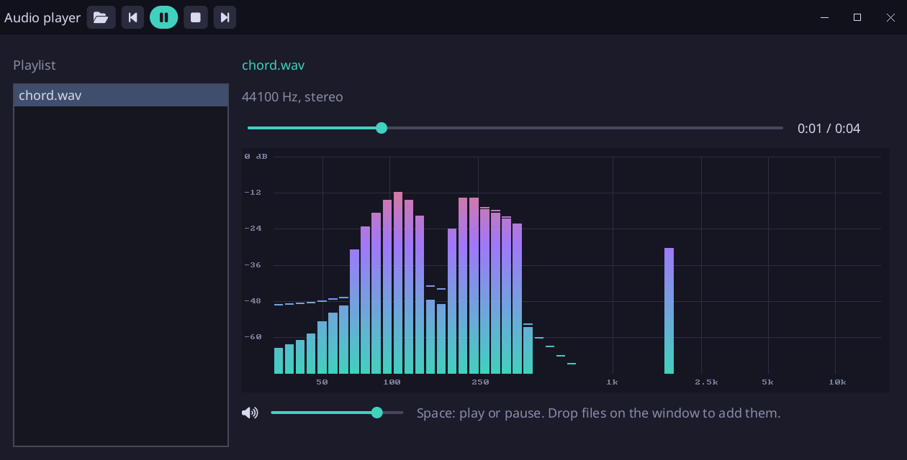

# Audio player

An audio player written in [Sosu](https://github.com/Clement-Bonet/Sosu): WAV, Ogg Vorbis, MP3 and FLAC files
played as they are read, a playlist, and the spectrum of what plays, from a Fourier transform written in Sosu.



## Run

From this folder, with `sosuc` built at the root of the repository and SDL3 installed (on Windows, run
`..\..\packages\platform\fetch-sdl3.ps1` once):

```
../../build/sosuc run .                          # the player, empty
../../build/sosuc run . -- song.mp3 album/*.flac # the player, with these files
../../build/sosuc run . -- --snapshot out.png    # draws the window into a PNG, no screen or sound card
../../build/sosuc test .                         # the tests
```

Open files with the folder button of the title bar (the dialog of the system), or drop them on the window. A
row of the playlist plays when it is clicked; at the end of a track, the next one plays. The title bar holds
previous, play or pause, stop and next; Space plays and pauses, Escape quits. The slider under the title moves
in the track, the one under the spectrum sets the volume. Previous goes back to the start of the track when it
has played more than three seconds, as players do.

## How it works

- `audio.stream` reads a file as it plays: it decodes into a ring of 3 seconds, which the mixer plays in a
  loop and the player fills again behind it at each frame. A song of four minutes takes its ring and its decoder,
  about 5 MB, rather than 80 MB of samples. Ogg Vorbis comes from stb_vorbis, MP3 and FLAC from dr_mp3 and dr_flac
  (taken from their repository by `[native.dr_libs]`), WAV from Sosu.
- `audio.spectrum` takes the last 2048 samples the device plays (the ring keeps 0.75 s behind the voice, and the
  player looks as far back as the device plays behind the mixer), through a Hann window and a fast Fourier
  transform, into 56 bands from 30 Hz to 16 kHz on a scale of octaves. A band rises at once and falls slowly;
  its peak holds a moment above it.
- `bars.sosu` draws them into a canvas of 900 by 340 pixels, which the interface shows as an image
  (`Image(m.picture())` in `screen.ui.sosu`), with lines every 12 dB and the frequencies below.
- `model.sosu` holds the playlist and the controls; `checks.sosu` tests it without a window nor a sound card
  (`Model.pump` mixes as the device would).

The fonts (`assets/NotoSans-Regular.ttf`, SIL OFL, and `assets/fa-solid-900.ttf`, Font Awesome Free, SIL OFL, for
the icons) are those of the other showcases; their licenses are in `assets/`.
