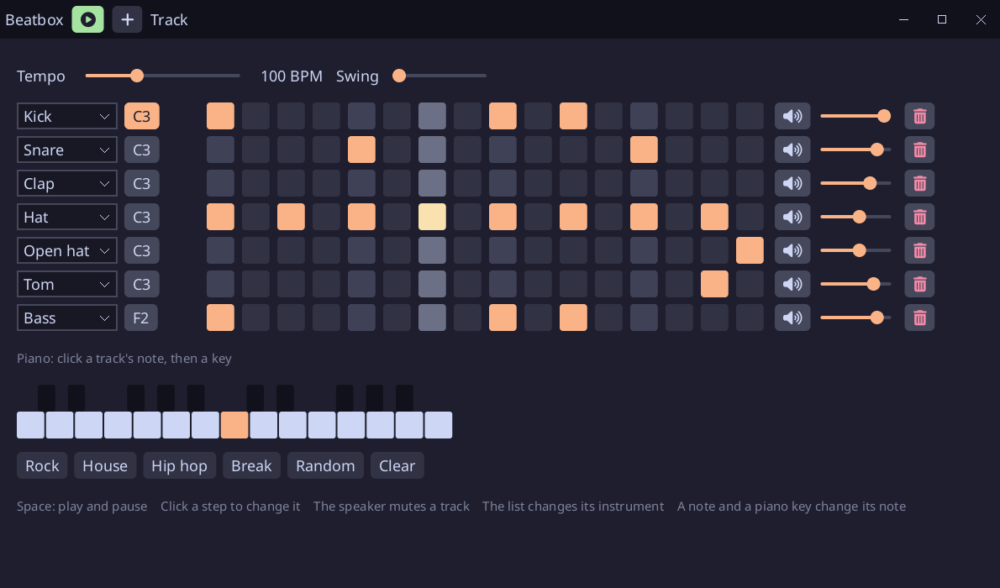

# Beatbox

A drum machine written in [Sosu](https://github.com/Clement-Bonet/Sosu): 16 instruments synthesized in code
(no sample files), up to 8 tracks on a 16-step grid, a note per track, tempo, swing, a level per track,
and four presets. Play, Pause and the tracks are in a title bar drawn by the program.



## Run

From this folder, with `sosuc` built at the root of the repository and SDL3 installed (on Windows, run
`..\..\packages\platform\fetch-sdl3.ps1` once):

```
../../build/sosuc run .                        # the machine
../../build/sosuc run . -- --snapshot out.png  # draws the window into a PNG, no screen or sound card
../../build/sosuc test .                       # the tests
../../build/sosuc package --release --target android .  # build/android/project/app/build/outputs/apk/debug/app-debug.apk
```

On a phone, the window stays landscape (`landscape: true` in `app.Config`), fills the width of the screen (the steps
share it) and its height (the scale of `ui` is made smaller until the window fits), and the list of an instrument
opens as a dialog. A window made lower on the desktop shrinks the same way. Build it with `--release` for a phone: in debug, a frame takes about
100 ms there, and the sound has to be mixed further in advance.

Click a step to toggle it, its speaker button to mute a track. The list of a track changes its instrument. Click the note of
a track to select it, then a key of the piano (C2 to C4) to change its note; the note is played at once. A track is removed with its trash button.
Space plays and pauses, Escape quits.

The fonts (`assets/NotoSans-Regular.ttf`, SIL OFL, and `assets/fa-solid-900.ttf`, Font Awesome Free, SIL OFL, for
the icons) are read from `assets/` when run from the project, or from beside the executable: to run
`build/beatbox.exe` elsewhere, copy both fonts next to it, with `SDL3.dll`.

## How it works

| File | Role |
|---|---|
| `src/sounds.sosu` | the 16 instruments: drums, percussion, a bass, a pluck, a lead, a bell, a zap |
| `src/machine.sosu` | the state: pattern, tempo, swing, levels, presets |
| `src/engine.sosu` | mixes the 16 steps into one stereo buffer that the mixer loops |
| `src/screen.ui.sosu`, `src/look.ui.sosu` | the window and its theme, in the UI language of Sosu |
| `src/main.sosu` | the window loop, the font, the snapshot mode |
| `src/checks.sosu` | the tests |

The timing does not depend on the frame rate: the whole loop is mixed in advance, so each step falls on
its exact audio frame. An edit mixes the loop again into the same buffer while it plays, so it never
restarts; only a new tempo restarts it.

## Checked and not checked

Checked: type checking, build and the 10 tests, on Windows, and by the CI on Linux and macOS (SDL dummy
drivers); the window drawn by `--snapshot`; the program on an Android phone, built with `--release` (the
sound, the dialog of its lists, landscape).

Not measured: the timing, the level and the pans of the sound, and the playhead against the audible beat
(it follows the system clock, not the audio clock). The window and the sound were not tried on Linux and
macOS.
