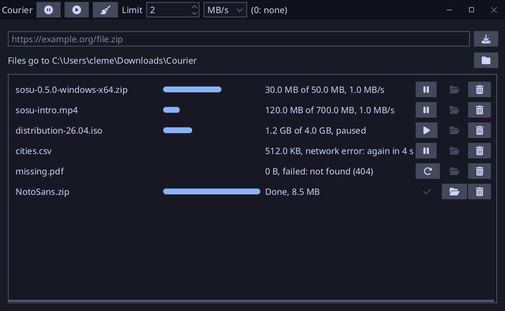

# Courier

A download manager written in [Sosu](https://github.com/Clement-Bonet/Sosu), on the package `net` (HTTP and HTTPS). Windows, Linux and macOS.



The buttons are icons (Font Awesome); their tooltips say what they do.

- Paste a URL (`Ctrl+V`) and press **Download** (the arrow into a tray), or Enter: the file goes to `Downloads/Courier` in the folder of the user.
- The **folder** button beside "Files go to" chooses another folder for the new downloads (a dialog of the system); Courier keeps it for its next runs, in its folder of data (`folder.txt`). A folder deleted since is made again, at the start and before each download writes in it.
- **Pause** a download, then **Resume** it (play): it goes on from the bytes already written, with a `Range` request (a server that answers with the whole file again starts it over).
- After an error (the network, a server that cuts the connection, a 5xx), a download **starts again by itself**, from where it stopped, after 1, 2, 4, 8, 16 seconds, then every 30 seconds; it gives up after 8 attempts in a row without a byte. A 404, a refused certificate or a wrong URL is not tried again: **Retry** (the round arrow) does it; the bin removes a download that does not run.
- **Limit**, in the title bar, keeps all the downloads to a bandwidth, in the unit chosen beside it (KB/s, MB/s or GB/s; 0: no limit), shared between those that run. The limit and its unit are kept for the next run, with the list.
- **Pause all** and **Resume all**, the two round buttons of the title bar; the **broom** beside them clears the finished downloads from the list (their files stay).
- The **bin** of a line takes the download out of the list, at any time: one that runs is paused first; a file not whole is deleted, a whole one stays.
- The list and the state of each download are kept when Courier closes (`downloads.json`, in its folder of data): those that ran start again at the next run, from the bytes already written; the others stay paused, failed or done.
- The **folder** button, once a download is whole, shows the file in the file manager, chosen: Explorer on Windows (through the shell, `native/reveal.c`), the Finder on macOS, and on Linux the file manager of the desktop (through D-Bus), or else its folder (`xdg-open`).
- The name of the file is the one the server gives (`Content-Disposition`, as for `https://dl.dafont.com/dl/?f=daydream_3`, which gives `daydream_3.zip`), or else the last part of the path of the URL. A download is written to `<first name>.part`, renamed to its name once whole; a name taken by another file gets ` (2)`, ` (3)`... A name is never a path: `../../x` gives `x`.

## How it works

Each download that runs has a thread of its own (`src/worker.sosu`): it reads blocks of the answer as they come (`net.http.open`, the file is never held in memory), appends them to the file, and sleeps when it is ahead of its share of the limit. It reads the commands of the window (`Pause`, a new `Limit`) between two blocks, from a channel, and tells what happens on another channel, at most ten times a second. The window (`src/model.sosu`) reads that channel at each frame with `try_receive`, without waiting, and decides the attempts and the shares.

The handler of the window starts threads from its methods, so it implements `app.Handler<uses time, threads>` (an interface with an effect parameter, spec 5.4).

The field of the URL holds 256 characters at most.

The window follows its width (responsive layouts, spec 10.2): narrower than 992 pixels, the state of each download is hidden; narrower than 768 (a phone), its progress and the limit of bandwidth too, and a download is its name and its three buttons. `Grid(columns: [...], md: [...], lg: [...])` gives the columns for each width, and `from: Md` hides a widget below it.

## Build

From this folder, with `sosuc` built at the root of the repository:

```
..\..\packages\platform\fetch-sdl3.ps1   # once, on Windows
..\..\build\sosuc.exe test .
..\..\build\sosuc.exe run .
```

`--snapshot out.png` writes the window in a picture, with downloads in each state (no thread runs). The tests run downloads against a server of their own on this machine: whole, paused and resumed, cut and resumed, refused, and kept to a rate. The fonts (`assets/`: Noto Sans, and Font Awesome for the icons, both OFL) are read from `assets/` or next to the program.

## Files

`native/reveal.c` (a file shown in Explorer), `src/job.sosu` (what the window and the threads say to each other), `src/worker.sosu` (one download), `src/files.sosu` (names, folder, sizes), `src/model.sosu` (the list, the buttons, the attempts and the limit), `src/main.sosu` (window), `src/screen.ui.sosu` (interface), `src/checks.sosu` (tests).
