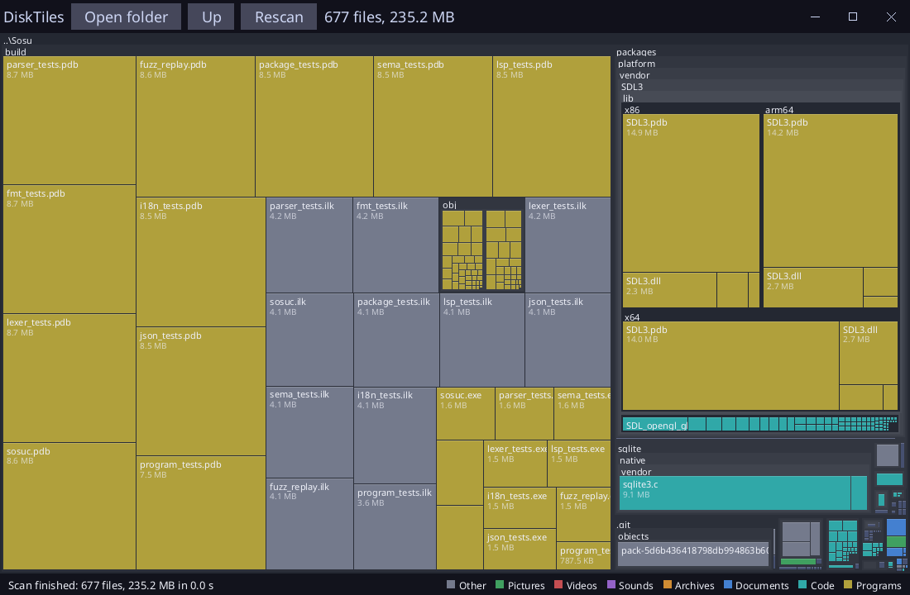

# DiskTiles

The size of the files and folders of a folder or a disk, as tiles (a treemap, as WinDirStat does), written in [Sosu](https://github.com/Clement-Bonet/Sosu). Windows, Linux and macOS.



- **Open folder**, or drop a folder on the window, or `disktiles <folder>`.
- A click goes into the folder under the mouse, one level at a time; **Up**, Backspace or the right button come back; **Rescan** reads again.
- The area of a tile is the size of the file or folder; the colors are the sorts of files (legend in the status bar).
- The scan runs a little at each frame: the window stays alive and the tiles grow while it reads.
- Links (symbolic links, junctions) are not followed, so a loop cannot trap the scan, and a size is not counted twice.

## Build

From this folder, with `sosuc` built at the root of the repository:

```
..\..\packages\platform\fetch-sdl3.ps1   # once, on Windows
..\..\build\sosuc.exe test .
..\..\build\sosuc.exe run .
```

`--snapshot out.png [folder]` writes the window in a picture without opening it. The font (`assets/`, Noto Sans, OFL) is read from `assets/` or next to the program.

## Files

`native/scan.c` (size of an entry without following links), `src/scan.sosu` (the tree, read in steps), `src/layout.sosu` (squarified treemap), `src/model.sosu` (state, status), `src/main.sosu` (window and drawing), `src/screen.ui.sosu` (title bar), `src/checks.sosu` (tests).
