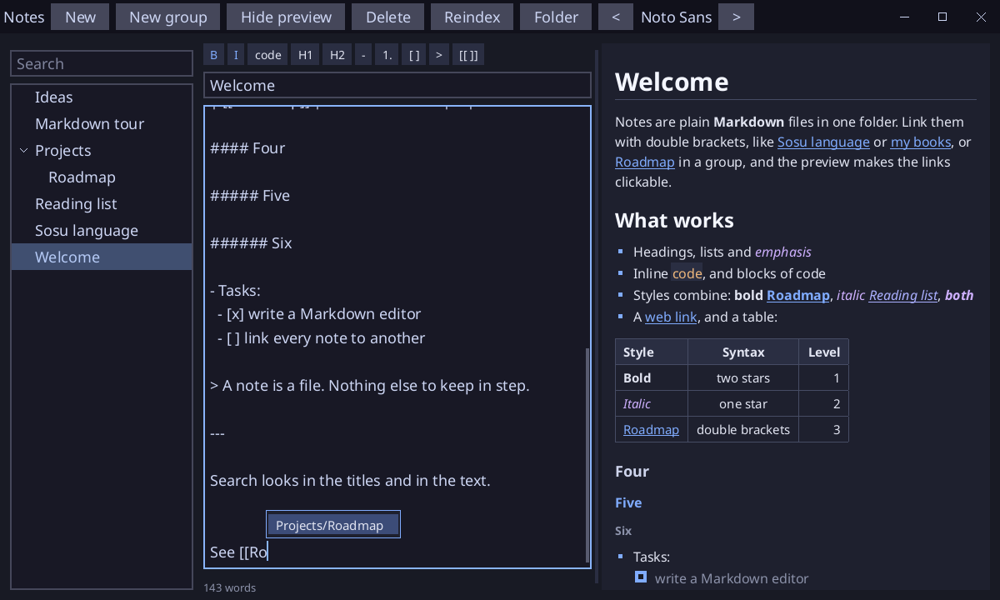

# Notes

A notes editor in the spirit of Obsidian, written in [Sosu](https://github.com/Clement-Bonet/Sosu). A note is a plain `.md` file in a folder; nothing else to keep in step.



- A **tree** of the notes of the folder and of its subfolders (click a triangle, or use Left and Right, to fold a group), with a **search** in the titles and in the text.
- A **live preview** next to the editor, drawn from a real parser of **CommonMark 0.31.2** (651 of the 652 examples of the specification give the exact HTML; the one left needs a rare named entity, such as `&ngE;`, of the 2000 of HTML5, of which about 100 are known) and **GitHub Flavored Markdown**: ATX and setext headings, nested lists (bullets, numbers) and quotes, tasks, fenced (``` or ~~~, with the language) and indented code, HTML blocks (shown as text), tables (alignment, escaped `\|`, no leading `|`), `~~strikethrough~~`, bare links, `<autolinks>`, links and images with titles or by reference, footnotes `[^1]`, backslash escapes, entities, hard and soft breaks, and combined styles. Web images are shown as their text.
- **Links** between notes with `[[Name]]`, `[[Name|shown text]]` or `[[Name#heading]]`. A click in the preview opens the note, and makes it if it is missing.
- **Obsidian**: ==highlights==, #tags, %%comments%%, > [!tip] callouts, $math$, ![[embeds]], [[Note#heading|alias]] and the properties between --- lines at the top of a note.
- **Backlinks**: the notes that link to the one open, under the preview.
- **Help with typing**: after `[[` a list of the notes that match what is typed (Up, Down, Enter or Tab, Esc; or a click) and the link is closed for you. Above the editor (with a tooltip after a short pause), buttons for **bold** (Ctrl+B), *italic* (Ctrl+I), code, headings, lists, numbered lists, tasks, quotes and links (Ctrl+K): on a selection they wrap it, a second press takes the mark off. Enter in a list starts the next item, and on an empty one ends the list.
- **Rename** a note by editing its title and pressing Enter, or a note or a group with F2 or the right-click menu of the tree: type the new path and press Enter (Esc cancels). The links to the notes moved are rewritten in every note.
- Drag the bar between the editor and the preview to change their sizes (20 to 80 %).
- Saved by itself after a pause in the typing, when another note is opened, and on quit (Ctrl+S saves at once).
- **Groups**: a subfolder is a group of notes. New notes and new groups go in the group of the row chosen in the tree. *New group* makes one and asks for its name at once. A title like Work/Plan moves the note into the group.
- **Folder of the notes**: the button Folder opens the folder dialog of the system. The notes of the folder chosen replace the ones shown, and it is remembered in `notes-folder.txt`, in the current folder, for the next start. A path given on the command line is used first.
- **Font**: the < and > buttons cycle through the .ttf fonts installed on the system (kept between runs).
- New (Ctrl+N), Delete, Reindex, Hide preview.

`notes.exe [folder]` opens `folder` (`notes` next to the program by default; it is made if missing).

## Limits

- The number of notes is only bounded by the system (files in a folder); paths are up to ~200 bytes, groups nest 8 deep. Groups cannot be deleted in the app.
- Only .ttf fonts are listed. Three families come with the program, each with its real Bold, Italic and Bold Italic faces (OFL): Noto Sans, Noto Serif and JetBrains Mono (the first three entries of the chooser, before the fonts of the system). A font you choose has no variants: bold is then drawn twice and italic is a colour.

## Directory of links

.notes-index (in the notes folder) lists every link between notes, so backlinks and renames do not read all files. It is updated on each save and load; *Reindex* rebuilds it after edits made outside the app. .notes-settings keeps the font.

## Build

From this folder, with `sosuc` built at the root of the repository:

```
..\..\packages\platform\fetch-sdl3.ps1   # once, on Windows
..\..\build\sosuc.exe test .
..\..\build\sosuc.exe run .
..\..\build\sosuc.exe package --release .   # build\package\notes, with its fonts
```

`--snapshot out.png` writes the window in a picture with a few demo notes, without opening a window. The fonts (`assets/`, Noto Sans, Noto Serif and JetBrains Mono, OFL) are read from `assets/` or next to the program.

## Files

`src/blk.sosu` and `src/inl.sosu` (the two phases of the parser: blocks, then inlines), `src/cm.sosu` (the tree and what the phases share), `src/html.sosu` (the HTML compared with the specification), `src/md.sosu` (lines, spans, links), `src/notes.sosu` (the folder, the open note, saving, backlinks), `src/screen.ui.sosu` (interface), `src/main.sosu` (window, input, preview), `src/checks.sosu` (tests), `spec/` (the examples of the CommonMark specification, CC BY-SA 4.0).
