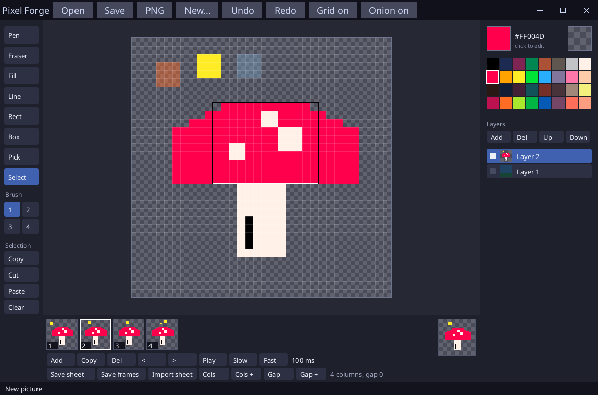

# Pixel Forge

A pixel art editor written in [Sosu](https://github.com/Clement-Bonet/Sosu).



- **Tools** (left, or the key): Pen `b`, Eraser `e`, Fill `f`, Line `l`, Rect `r`, Box `x`, Pick `i`, Select `m`. Brush of 1 to 4 pixels (keys `1` to `4`).
- **Selection** (Select tool): drag to select a rectangle, drag inside it to move its content (it leaves a hole). Copy / Cut / Paste / Clear (buttons, Ctrl+C, Ctrl+X, Ctrl+V, Delete); Ctrl+A selects all, Escape deselects. They work on the active layer. Paste puts the copy at the top left of the view, and it can be dragged until you do something else (click outside, Enter, another tool or frame). The copy is kept when you change frame, so it can be pasted in another one.
- **Onion skin** (`o` or the Onion button): the previous frame in red and the next one in blue, faint, under the picture (they show where the picture is transparent or its layers are hidden).
- **Colors** (right): a palette of 32 colors, the transparent color (the checkerboard) and a color picker: click the current color to open a hue wheel with a saturation/lightness triangle. Under it, choose RGB, CMYK or HSL and click a number to type it (Tab goes to the next one, Enter applies) or drag its bar; the last row is the opacity (0-255 in RGB, a percentage otherwise). A hex code can also be typed. OK (or Enter) keeps the color, Cancel (or Esc) restores the previous one. Pick takes the color seen under the mouse.
- **Layers**: add, delete, up, down, show or hide (the square), select. Each layer has a thumbnail of its own content (dimmed red when hidden). The layers are drawn from the bottom.
- **View**: wheel or `+` `-` to zoom around the mouse; right or middle button and drag to move the picture; `g` or the button shows the grid.
- **History**: Ctrl+Z, Ctrl+Y (or Ctrl+Shift+Z), across all the frames: undo goes to the frame of the last action and undoes it there. A change of layers forgets the history of that frame.
- **Files**: Open (Ctrl+O, a PNG or a `.pforge` project, or drop one on the window). Save (Ctrl+S) writes a `.pforge` project: all frames, layers, durations and sheet settings. PNG writes the visible layers of the current frame, flattened. *New...* (Ctrl+N) asks for the width and height of the picture, from 1 to 1024 pixels each (for example 48x24), with 16, 32, 64 and 128 presets for each side. The *Link width and height* box keeps the picture square: changing one size changes the other; unchecked, they are independent.
- **Frames** (strip below the picture): Add (empty), Copy, Del, `<` `>` (move the frame), Play/Stop (space), Slow/Fast (time of the current frame, 20 to 2000 ms). Click a thumbnail to draw in it; `,` and `.` go to the previous and next frame. Each frame has its own layers. The square at the right previews the animation.
- **Sprite sheets**: *Cols* and *Gap* set the grid (columns, pixels between frames). *Save sheet* writes `name.png` (the frames, flattened, in a grid) and `name.json` (the position, size and duration of each frame, for a game). *Save frames* writes `name_001.png`, `name_002.png`... *Import sheet* cuts a PNG in frames the size of the current picture (create it with New... first; the Gap is used too).

## Build

From this folder, with `sosuc` built at the root of the repository:

```
..\..\packages\platform\fetch-sdl3.ps1   # once, on Windows
..\..\build\sosuc.exe test .
..\..\build\sosuc.exe run .
```

`--snapshot out.png` writes the window in a picture. The font (`assets/`, Noto Sans, OFL) is read from `assets/` or next to the program.

## Limits

A PNG has one layer: use a project to keep layers. The undo history is not saved and is cleared when opening or importing a sheet. Pictures up to 1024 x 1024, 8 layers, 64 frames. No animated GIF.

## Files

`src/sheet.sosu` (layers, drawing, fill, history), `src/editor.sosu` (tools, zoom, mouse, files), `src/main.sosu` (window and drawing), `src/screen.ui.sosu` (title bar), `src/project.sosu` (`.pforge` format), `src/checks.sosu` (tests).
