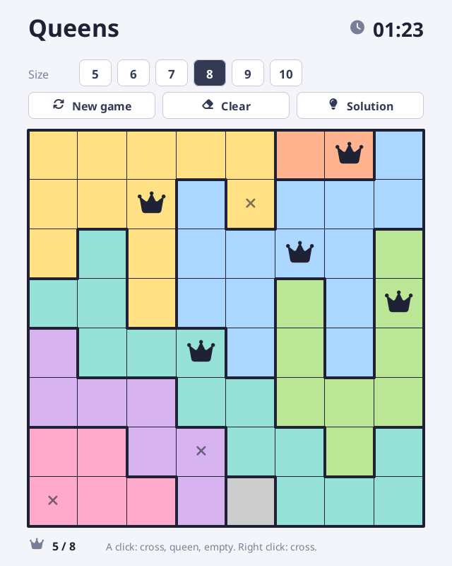

# Queens

The puzzle of the queens, written in [Sosu](https://github.com/Clement-Bonet/Sosu). The board is cut into as many coloured regions as it has rows: put one queen in each row, each column and each region, with no two queens touching, not even by a corner.



## How to play

- Buttons **5** to **10**: the length of a side (a new game starts).
- **New game**: a new grid. **Clear**: empties the board. **Solution**: shows the solution.
- Left click on a square: a cross (a note that says "no queen here"), then a queen, then empty.
- Right click: puts or takes off a cross.
- Keyboard: `N` new game, `C` clear, `S` solution, `Escape` quit.
- The clock starts at the first click, and stops when the grid is solved or the solution is shown.
- Queens that conflict are drawn in red.

## The grids

Each grid has **one solution only**. The generator (`src/board.sosu`) places queens at random, grows a region around each one, then moves squares from one region to another as long as this adds no solution, until only one is left (counted by backtracking).

## Build

From this folder, with `sosuc` built at the root of the repository:

```
..\..\packages\platform\fetch-sdl3.ps1   # once, on Windows
..\..\build\sosuc.exe test .
..\..\build\sosuc.exe run .
```

`.\build\queens.exe --snapshot out.png` writes the window in a picture. The fonts (`assets/`, Noto Sans and Font Awesome Free, SIL OFL, in `OFL.txt` and `FontAwesome-LICENSE.txt`) are read from `assets/`.

## Files

`src/board.sosu` (the rules, with no window: generator, solver, conflicts, victory), `src/main.sosu` (window, buttons, drawing), `src/checks.sosu` (tests).
