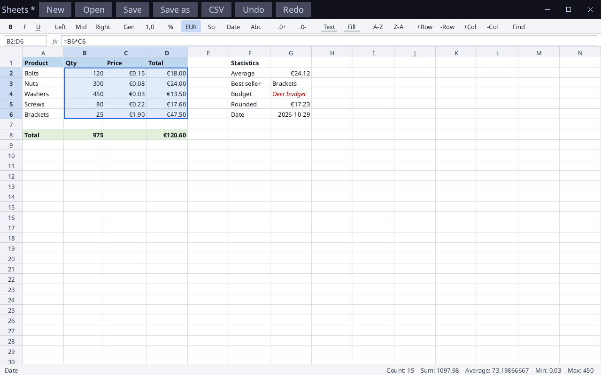

# Sosu Sheets

Un tableur façon Excel écrit en Sosu : une feuille de 100 colonnes × 2000 lignes, un moteur de formules (~120 fonctions), des formats, des couleurs, l'annulation illimitée (100 niveaux), des fichiers `.sheet`, `.ods` et `.csv`.



## Lancer

```
Sosu\packages\platform\fetch-sdl3.ps1      (une seule fois)
sosuc run Sheets
sosuc test Sheets                          (18 tests : moteur, éditeur, fichiers, ZIP/XML, OpenDocument)
sosuc build Sheets  puis copier assets\ dans build\assets
build\sheets.exe --snapshot sortie.png     (image de la fenêtre avec une feuille de démonstration)
```

## Saisie

- Taper dans une cellule remplace son contenu ; **F2** ou double-clic modifie ; **Entrée** valide et descend (Maj : monte), **Tab** valide et va à droite, **Échap** annule.
- Une formule commence par `=`. Pendant la saisie d'une formule, un clic sur une cellule insère sa référence (`A1`, `$A$1`, `A1:B5`).
- Une apostrophe force le texte (`'007`). Les nombres, pourcentages (`12%`), dates `aaaa-mm-jj`, `TRUE`/`FALSE` sont reconnus.
- Erreurs : `#DIV/0!`, `#REF!`, `#NAME?`, `#VALUE!`, `#N/A`, `#NUM!`, `#CIRC!` (référence circulaire).

## Raccourcis

| Touche | Action |
|---|---|
| Flèches, Maj+flèches | déplacer, étendre la sélection |
| Ctrl+flèches | aller au bord du bloc de données |
| Début, Ctrl+Début, Ctrl+Fin, PgPréc/PgSuiv | navigation |
| Ctrl+A | tout sélectionner |
| Ctrl+C / X / V | copier, couper, coller (via le presse-papiers système, collage depuis Excel possible) ; les références relatives sont décalées |
| Ctrl+D / Ctrl+R | recopier vers le bas / la droite |
| Ctrl+Z / Ctrl+Y | annuler / rétablir |
| Ctrl+B / I / U | gras, italique, souligné |
| Ctrl+G | aller à une cellule (ou clic sur la boîte de nom) |
| Ctrl+F, F3 | rechercher, suivant |
| Ctrl+N / O / S | nouveau, ouvrir, enregistrer |
| Suppr | effacer le contenu |

La souris : clic et glisser pour sélectionner, clic sur un en-tête de colonne ou de ligne pour la sélectionner, glisser le bord d'un en-tête pour redimensionner une colonne, molette pour défiler (horizontalement avec le défilement latéral).

## Barre d'outils

Gras / italique / souligné, alignement (gauche, centre, droite), formats (Général, Nombre, %, Monnaie €, Scientifique, Date, Texte), décimales ± , couleur du texte et du fond (chaque clic passe à la couleur suivante), tri A→Z / Z→A (par la colonne active, sur la sélection ou sur toute la zone utilisée), insertion/suppression de lignes et de colonnes (les références des formules sont réécrites), recherche. La barre d'état affiche Nombre, Somme, Moyenne, Min et Max de la sélection.

## Fonctions

- **Mathématiques** : SUM, PRODUCT, ABS, ROUND, ROUNDUP, ROUNDDOWN, INT, MOD, POWER, SQRT, EXP, LN, LOG, LOG10, SIGN, CEILING, FLOOR, TRUNC, PI, RAND, RANDBETWEEN, SIN, COS, TAN, ASIN, ACOS, ATAN, ATAN2, DEGREES, RADIANS, FACT, GCD, LCM, QUOTIENT, SUMPRODUCT, SUMSQ…
- **Statistiques** : AVERAGE, MEDIAN, MODE, MIN, MAX, COUNT, COUNTA, COUNTBLANK, LARGE, SMALL, RANK, STDEV, VAR…
- **Conditionnelles** : IF, IFERROR, IFNA, AND, OR, NOT, XOR, SUMIF, SUMIFS, COUNTIF, COUNTIFS, AVERAGEIF…
- **Texte** : LEN, LEFT, RIGHT, MID, UPPER, LOWER, PROPER, TRIM, CONCAT, CONCATENATE, TEXTJOIN, FIND, SEARCH, SUBSTITUTE, REPLACE, REPT, TEXT, VALUE, EXACT, CHAR, CODE…
- **Recherche** : VLOOKUP, HLOOKUP, INDEX, MATCH, CHOOSE, ROW, COLUMN, ROWS, COLUMNS…
- **Dates** : TODAY, NOW, DATE, YEAR, MONTH, DAY, WEEKDAY, DAYS…
- Opérateurs : `+ - * / ^ & = <> < <= > >=`, `%` postfixe, plages `A1:B5`, références absolues `$A$1`.

## Fichiers

- `.sheet` : format texte natif (contenus, formats, couleurs, largeurs de colonnes).
- `.ods` (OpenDocument) : lecture et écriture, une feuille. Conservés : valeurs, formules (`of:=SUM([.A1:.B2])`), gras/italique/souligné, alignement, formats, couleurs, largeurs. Perdus : autres feuilles, graphiques, mise en forme conditionnelle. Le conteneur ZIP (`zip.sosu`), l'analyseur XML (`xml.sosu`) et la conversion (`ods.sosu`) sont dans `src`.
- `build\sheets.exe --convert entrée sortie` convertit un fichier (`.csv`/`.sheet`/`.ods` vers `.sheet` ou `.ods`).
- `.csv` : import (séparateur `,` ou `;`, guillemets) et export. Un fichier déposé sur la fenêtre est ouvert.

## Limites

Une seule feuille, pas de graphiques, pas de formules matricielles, pas de mise en forme conditionnelle. Le recalcul est complet à chaque modification.

L'interface a été vérifiée par captures (`--snapshot`) et par les tests, pas dans une fenêtre interactive.
