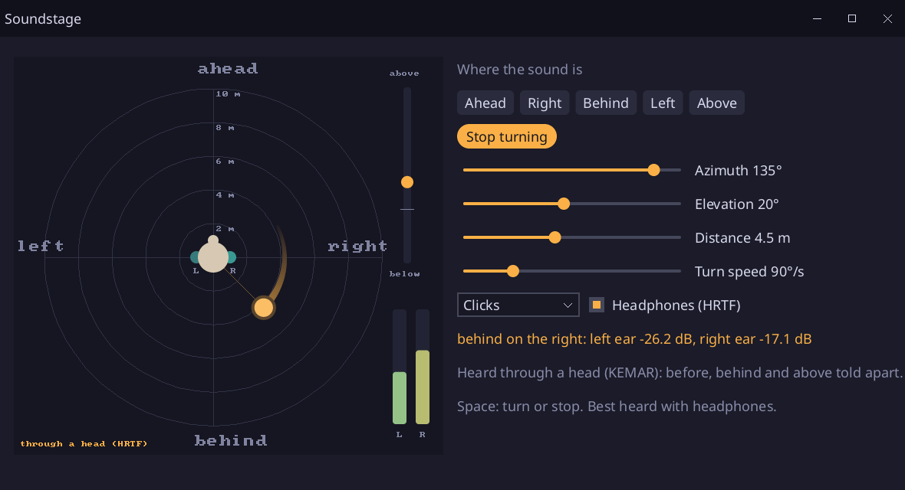

# Soundstage

A sound placed around the listener, written in [Sosu](https://github.com/Clement-Bonet/Sosu): ahead, behind, on the
left, on the right, above, or turning around the head. It is heard panned, as most games do, or through a head
(`audio.hrtf`), which tells ahead from behind and above from below: put on headphones.



## Run

From this folder, with `sosuc` built at the root of the repository and SDL3 installed (on Windows, run
`..\..\packages\platform\fetch-sdl3.ps1` once):

```
../../build/sosuc run --release .                # the soundstage (a head costs less in a build --release)
../../build/sosuc run . -- --snapshot out.png    # draws the window into a PNG, no screen or sound card
../../build/sosuc test .                         # the tests
```

The buttons put the sound ahead, on the right, behind, on the left or above; "Turn around the head" makes it go
around (Space too), at the speed of its slider. The sliders place it by hand: its azimuth (0 ahead, 90 on the right,
180 behind), its elevation (from 40 degrees below to above the head) and its distance. Three sounds: clicks of noise,
the easiest to place, since they hold every frequency the head filters; a chime; an engine. "Headphones (HRTF)" hears
it through a head, or panned when it is unchecked: turn it off and on while the sound is behind you to hear what
a head adds. Escape quits.

## How it works

- `model.sosu` places the sound in a space of `audio.spatial`: the listener at the middle facing ahead, the sound at
  its azimuth, elevation and distance, moved each frame when it turns. The space gives the mixer its volume (from
  its distance) and its direction.
- Panned, the mixer shares the sound between the two ears by its direction left and right only: ahead and behind
  are the same, and the space makes what is behind a little duller to tell them apart.
- Through a head, the mixer convolves the sound with the responses of the two ears for its direction, measured on
  KEMAR, a dummy head, by Bill Gardner and Keith Martin at the MIT Media Lab (1994; free, the authors cited:
  `THIRD_PARTY_NOTICES.md`): the ear on the side of the sound hears it first and louder, and the outer ear shades
  what comes from behind or from above in its own way.
- `stage.sosu` draws the scene from above into a canvas of 560 by 520 pixels, shown as an image: rings every 2
  meters, the head and its ears lit by what they hear, the trail of the sound, its height on a gauge, and a meter per
  ear. The levels of the ears are those of the panning, or the power of the responses of the head.
- `sounds.sosu` makes the sounds, `checks.sosu` tests it without a window nor a sound card (`Model.pump` mixes as
  the device would): the ear on the side louder, ahead and behind told apart through a head and not panned, the turn,
  the distance.

The fonts (`assets/NotoSans-Regular.ttf`, SIL OFL, and `assets/fa-solid-900.ttf`, Font Awesome Free, SIL OFL) are
those of the other showcases; their licenses are in `assets/`.
