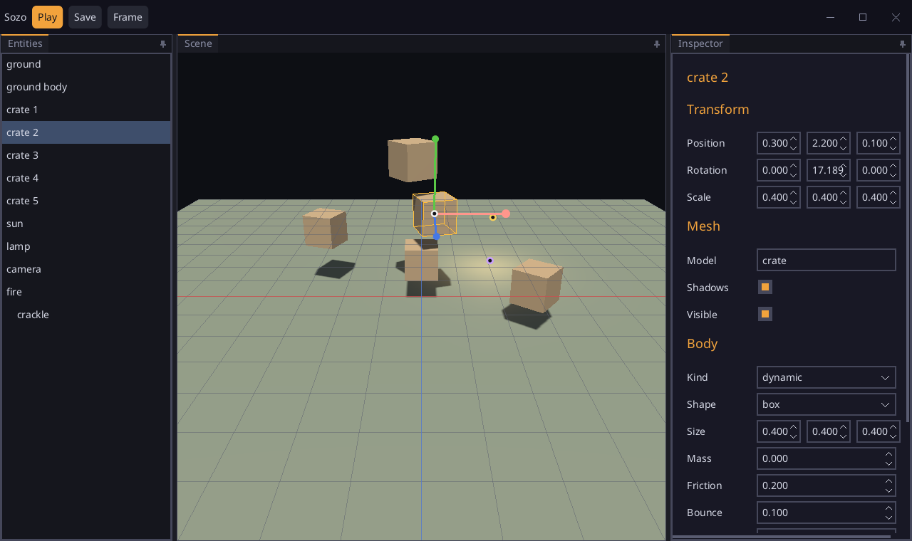

# Sozo

The first draft of Sozo, the editor of games of [Sosu](https://github.com/Clement-Bonet/Sosu). It becomes an
application of its own once its pieces are stable; they are written as the packages `engine` (the common components of a
game and what makes them run) and `editor` (the camera of an editor, choosing, the gizmo, the marks over the view).



## Run

From the root of the repository, with `sosuc` built and SDL3 installed (on Windows, run
`packages\platform\fetch-sdl3.ps1` once):

```
build/sosuc run showcase/sozo                        # the scene of examples/scene
build/sosuc run showcase/sozo -- path/scene.json     # another scene
build/sosuc run showcase/sozo -- --snapshot out.png  # the window drawn into a PNG, without a screen
build/sosuc test showcase/sozo                       # the tests
```

A click in the view or in the list chooses an entity: its box is drawn, and three arrows (x red, y green, z blue) move
it along one axis when dragged. The inspector, on the right, shows where it is (its turn in degrees) and the fields of
each of its components, and changes them as they are typed. The right button turns the camera of the editor around
what it looks at, Shift and the right button (or the middle one) slide it, the wheel brings it nearer; F frames what
is chosen. The panels are arranged as in Visual Studio (`ui.dock`): a splitter dragged resizes them, a tab dragged shows
guides (into the tabs of a group, beside it, or on a side of the window), a pin hides a group on its side, from where it
slides out under the mouse. A tab dropped over no guide floats in a window of its own, where panels are arranged as in
the main one: a tab dropped onto the guides of a floating window joins it, the strip of a floating window dragged brings
it whole over the guides of another window (it follows the mouse, faded), its pin or its close button docks its panels
back where they were. The arrangement is kept from one run to the next (`layout.json`, in the folder of the data of
Sozo: `%APPDATA%\sosu\sozo` on Windows). Play runs the scene as the game would (the crates fall, the fire burns, seen through the camera of the
scene); Stop brings it back as it was. Save writes the scene to its file.

## How it works

- The window is drawn by the GPU. The interface of `ui` is drawn into a canvas, with a hole where the view is
  (`canvas.erase`); the scene is drawn into a texture of the size of the view (`engine.Engine.render_into`) and copied
  there (`gpu.Frame.blit`); the canvas goes over it all (`gpu.overlay`). The grid, the box of what is chosen, the arrows
  and the places of what has no mesh (`editor.marks`) are drawn into the hole of the canvas: always over the scene, as in
  the editors.
- `studio.sosu` holds what is edited: the scene and its engine, paused while editing (`Engine.paused`: nothing falls nor
  plays, the files still load), seen through the camera of the editor (`Engine.looking`, `editor.camera`). A click is a ray
  (`editor.marks.ray_at`) tested against the box of each entity (`editor.pick`); an arrow dragged moves the entity to the
  point of its axis nearest to the ray under the mouse (`editor.gizmo`). Playing saves the scene (`engine.components`),
  stopping reads it back.
- The panels (`studio.Workspace`, called by `screen.ui.sosu` as a component) are those of a `ui.dock.Dock`; the panel of
  the view makes the hole of the canvas where it is this frame, and draws the marks into it, so that what the dock draws
  after (a panel slid out, the guides of a drag) stays over the scene. A click goes to the view only when no panel covers it.
- Each floating window of the dock has a window of the system (`app.open_window`), drawn by the same GPU device
  (`Device.claim`, `begin_on`), with its own interface and canvas (`main.sosu`, `Floater`; `studio.Floating`); the events
  say which window they belong to (`Event.Target`). When the view floats, the scene is drawn into its window.
- The inspector (`studio.inspector`) draws, for the entity chosen, its
  transform and each of its components field by field, from their descriptions (`editor.inspect`, `engine.describe`).
- `checks.sosu` tests it without a window nor a GPU: choosing by a click, the gizmo, the camera, playing and stopping,
  saving, the inspector of every entity. Its scene is `tests/level.json`, which a save never writes over.
- Not yet: undoing, adding and removing entities and components, the arrows that turn and scale.

The fonts (`assets/NotoSans-Regular.ttf`, SIL OFL, and `assets/fa-solid-900.ttf`, Font Awesome Free, SIL OFL) are those
of the other showcases; their licenses are in `assets/`. `assets/level.json` is the scene of `examples/scene`.
