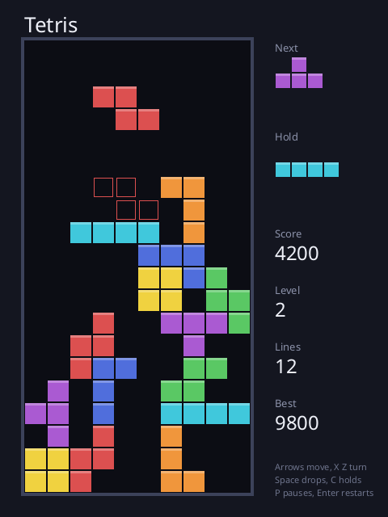

# Tetris

The falling blocks, written in [Sosu](https://github.com/Clement-Bonet/Sosu). Windows, Linux and macOS.



- Seven pieces drawn from a **bag** (each comes once in seven), a **next** piece, a **hold**, and a **ghost** where the piece will land.
- Turns are pushed aside from a wall (up to two squares), as in the modern game.
- Score: 100, 300, 500 or 800 for 1 to 4 lines, times the level; 1 point per row of soft drop, 2 per row of hard drop. The level goes up every 10 lines, and gravity from 800 ms to 80 ms.
- The rules are in `src/board.sosu`, with no window, and are tested on their own.

| Key | |
|---|---|
| Left, Right | move |
| Up or X, Z | turn clockwise, back |
| Down | soft drop |
| Space | hard drop |
| C | hold |
| P | pause |
| Enter | new game |
| Escape | quit |

## Build

```
..\Sosu\packages\platform\fetch-sdl3.ps1   # once, on Windows
..\Sosu\build\sosuc.exe test .
..\Sosu\build\sosuc.exe run .
..\Sosu\build\sosuc.exe package --release .   # build\package\tetris, with its font
```

`--snapshot out.png` writes a game in progress in a picture, without opening a window. The font (`assets/`, Noto Sans, OFL) is read from `assets/` or next to the program.

## Files

`src/board.sosu` (pieces, turns, lines, score, bags), `src/main.sosu` (window, input, drawing), `src/checks.sosu` (tests).
