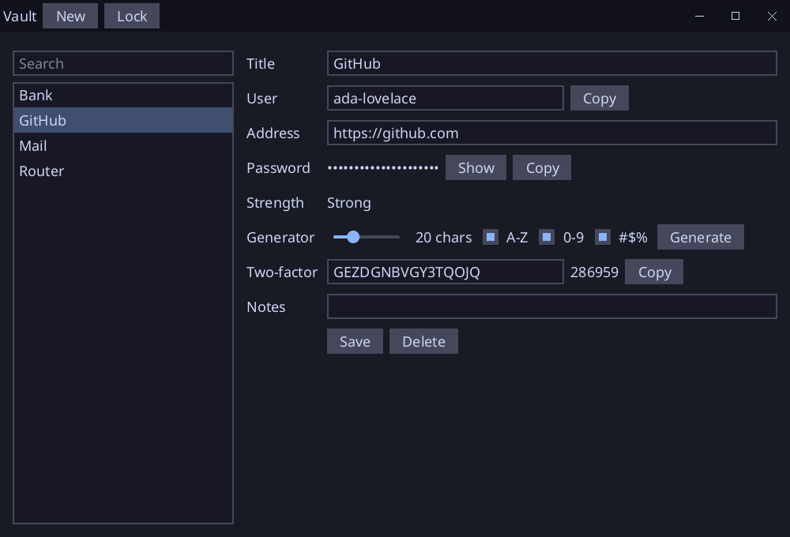

# Vault

A password manager written in [Sosu](https://github.com/Clement-Bonet/Sosu), with its own encryption, an SQLite file and an SDL window. Windows, Linux and macOS.



- One **master password** opens the vault; nothing is stored in clear in the file.
- Accounts with title, user, address, password, notes and a **two-factor secret**: the 6-digit code (TOTP, RFC 6238) is shown live.
- **Search** while you type, **password generator** (length, capitals, digits, symbols; no look-alike characters) and a strength estimate.
- **Copy** puts a secret on the clipboard, and it is emptied after 30 seconds; the vault **locks** itself after 5 minutes without input, and wipes the accounts from memory.
- The password of an account is drawn as dots until **Show**.

## How it is sealed

The stdlib has no cipher, so `src/chacha.sosu` is ChaCha20 (RFC 8439) written in Sosu, and `src/seal.sosu` adds HMAC-SHA256 (encrypt, then MAC). `src/kdf.sosu` is PBKDF2-HMAC-SHA256 (600,000 rounds, stored in the file: a vault keeps the number it was created with).

- The master password and a random salt give 64 bytes: a key to encrypt and a key to authenticate.
- Each account is one row of `entries`: a random 12-byte nonce, the encrypted account, and a 32-byte tag. A row that is changed in the file does not open.
- `meta` holds the salt, the rounds, and a sealed check text, which tells a wrong password from a damaged file.
- The nonces and the salt come from the system's random source.

**This is a showcase, not audited software.** The cipher and the key derivation are checked against the RFC test vectors, but a real vault should use a reviewed library. The memory of the process is not locked or scrubbed beyond what `Lock` does, and a master password cannot be recovered.

## Build

From this folder, with `sosuc` built at the root of the repository:

```
..\..\packages\platform\fetch-sdl3.ps1   # once, on Windows
..\..\build\sosuc.exe test .
..\..\build\sosuc.exe run --release .    # or: vault.exe my.db
```

Use `--release`: the 600,000 rounds take about a second there, and about 16 seconds in debug, while the window waits. `vault.db` in the current folder is the default file; it is created with the first master password. `--snapshot out.png` writes the window in a picture, with demo accounts in a vault in memory. The font (`assets/`, Noto Sans, OFL) is read from `assets/` or next to the program.

## Files

`src/chacha.sosu` (ChaCha20), `src/kdf.sosu` (PBKDF2), `src/seal.sosu` (keys, seal and open), `src/rand.sosu` (random bytes), `src/gen.sosu` (generator, strength), `src/totp.sosu` (base32, TOTP), `src/entry.sosu` (an account as bytes), `src/store.sosu` (the SQLite file), `src/model.sosu` (state), `src/main.sosu` (window, unlock screen, clipboard), `src/screen.ui.sosu` (interface), `src/checks.sosu` (tests).
